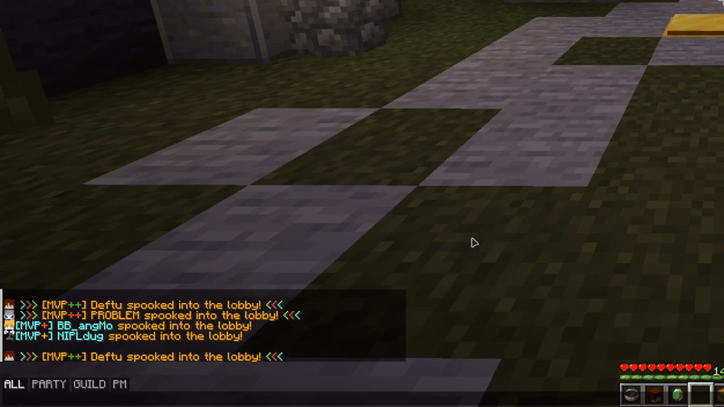
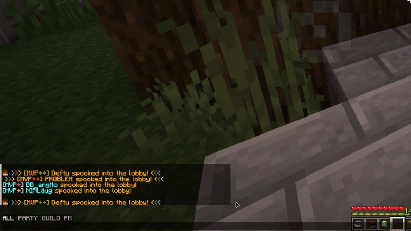
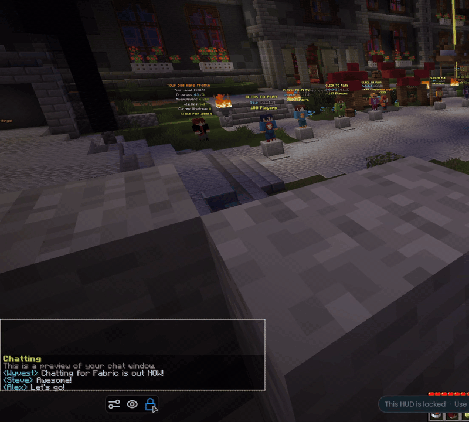
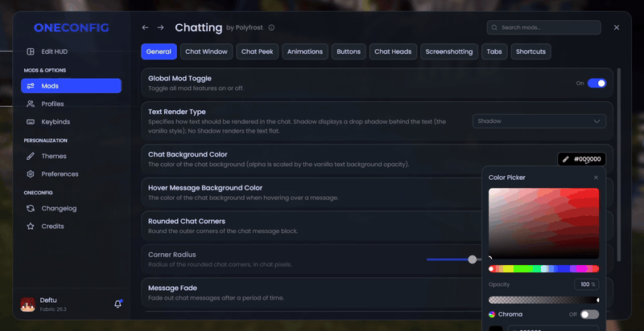
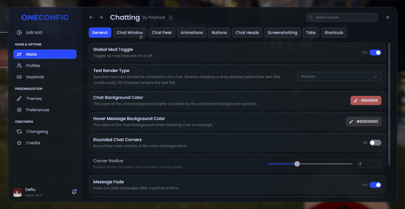

# Chatting

Chatting is a rework of the Minecraft chat, with a bunch of new things added on.

### Chat tabs

Filter your chat with tabs! The default ALL, PARTY, GUILD and PM tabs are made for Hypixel, and anything you type while a tab is selected goes to that channel (no more typing `/pc`).

- Shift-click to select more than one tab at once
- Make your own tabs with prefix, suffix, substring and regex rules (see the [chat tabs guide](docs/chattabs.md))
- Tabs only show up on Hypixel unless you turn that restriction off

### Message buttons

Hover over a message to copy it, delete it or save it as an image. The image can go to a file, your clipboard or both.

- Search your chat for any text
- Clear your whole chat history with one button
- Ctrl + right click to copy a message

### Chat window

- Move and scale the chat in the OneConfig HUD editor
- Set an exact width, plus separate heights for when the chat is open and closed
- Change the background color, round the corners or remove the text shadow
- Choose how long messages stay on screen before they fade

### Extras

- Player heads with a 3D hat layer next to chat messages
- Peek at the chat and scroll it while you keep moving
- Animated new messages and smooth scrolling
- Chat shortcuts that turn a short alias into a full command (Hypixel only, unless you change that)

## Compatibility

Chatting doesn't work together with Chat Patches. If you have the Chat Heads mod installed, it's turned off while Chatting's own chat heads are enabled.

## Supported versions

- Minecraft 1.8.9 on Ornithe.
- Minecraft 1.21.1-26.3 on Fabric.

Chatting needs [OneConfig](https://modrinth.com/mod/oneconfig) and Fabric Language Kotlin.

## Support

- Report bugs and ask questions on the [Polyfrost Discord](https://polyfrost.org/discord).
- Check [Polyfrost Status](https://status.polyfrost.org/) if a Polyfrost service is down.
