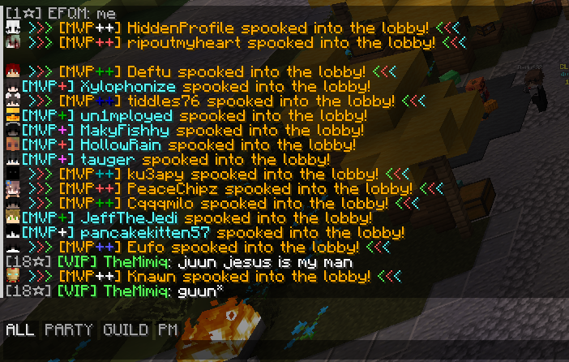

# Chatting

[](https://modrinth.com/mod/chatting)
[](https://www.curseforge.com/minecraft/mc-mods/chatting)

Chatting adds tabs, search, message buttons and player heads to the Minecraft chat. It also lets you move, resize and recolor the chat window.

## Features

### Chat tabs

A tab shows only the messages that match its rules. The default tabs are ALL, PARTY, GUILD and PM, and they match Hypixel's chat channels. While you have a tab selected, Chatting sends your messages to that channel, so a message you type in the PARTY tab goes out with `/pc` in front. Shift-click to select more than one tab.

Tabs only turn on while you play on Hypixel. You can switch that restriction off and write your own tabs with prefix, suffix, substring and regex rules. The [chat tabs guide](docs/chattabs.md) explains the file format.



### Search

The search button opens a search box while the chat is open. Chatting then shows only the messages that contain your text, ignoring case.

### Message buttons

Hover over a message to copy it, delete it or save it as an image. Chatting can write the image to a file, put it on your clipboard or do both. An option lets you copy a message by holding Ctrl, or Cmd on macOS, and right-clicking it. A separate button clears your whole chat history.

### Chat heads

Chatting draws the sender's head next to each player message, with the hat layer in 3D. It hides the head when the same player sends several messages in a row.

### Chat window

- Drag and scale the chat in the OneConfig HUD editor.
- Set an exact width, and separate heights for open and closed chat.
- Change the background color, round the corners and turn the text shadow off.
- Choose how long messages stay on screen before they fade.

### Chat peek

Bind a key to view and scroll the chat while you keep moving. The key works as hold or toggle.

### Animations

Chatting animates new messages and chat scrolling. You set each duration between 0 and 1000 ms, and 0 turns the animation off.

### Shortcuts

Shortcuts replace a short alias with a longer command when you send a message. You create and edit them in the settings screen. Like tabs, they only turn on while you play on Hypixel unless you change that.

## Supported versions

- Minecraft 1.8.9 on Ornithe.
- Minecraft 1.21.1, 1.21.4, 1.21.5, 1.21.8, 1.21.10, 1.21.11, 26.1, 26.2 and 26.3 on Fabric.

Chatting needs [OneConfig](https://modrinth.com/mod/oneconfig) and Fabric Language Kotlin.

## Compatibility

- Chatting does not load alongside Chat Patches.
- Chatting turns off the Chat Heads mod while its own chat heads are on.

## Support

- Report bugs and ask questions on the [Polyfrost Discord](https://polyfrost.org/discord).
- Check [Polyfrost Status](https://status.polyfrost.org/) if a Polyfrost service is down.

## Building

```sh
./gradlew ":26.3:build"
```

Replace `26.3` with any supported Minecraft version. The build needs JDK 21 and JDK 25 installed.
